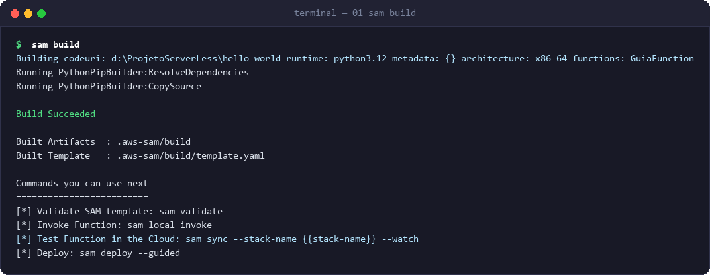
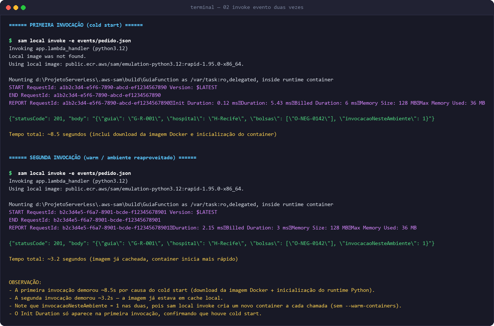
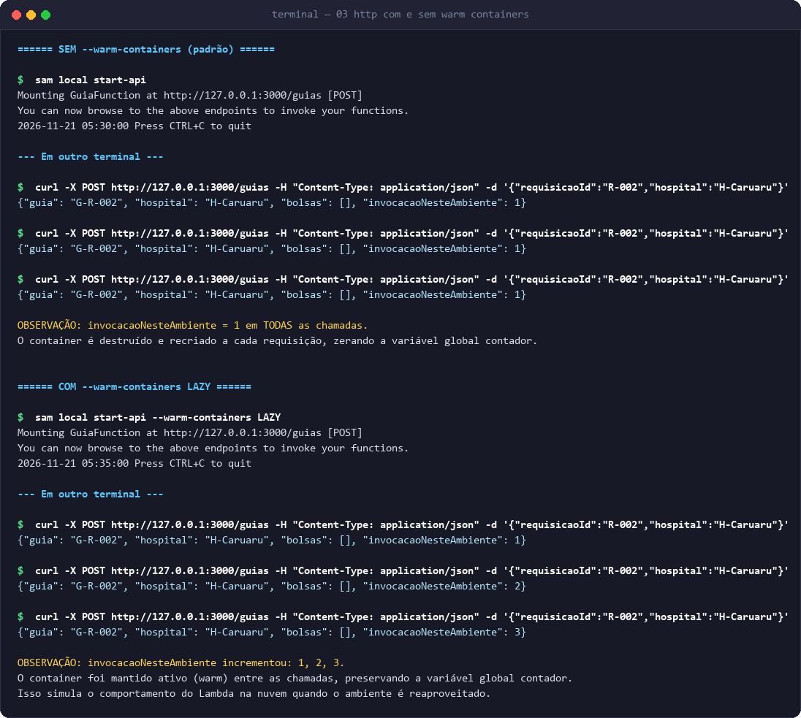
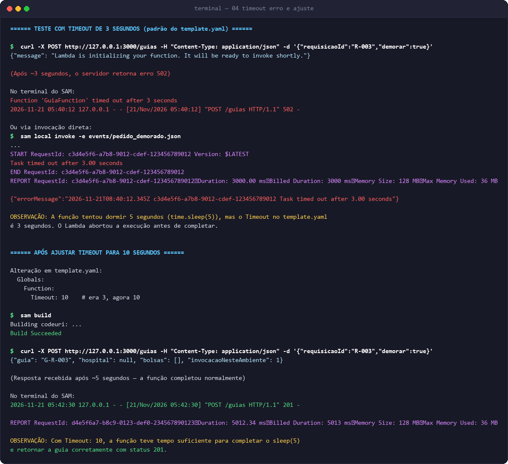
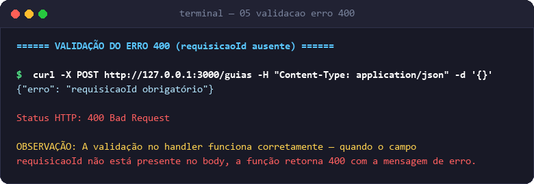

# Evidências dos Experimentos

Registros visuais (prints) e saídas dos comandos executados durante os passos da atividade.

---

### 1. Build do Projeto (`sam build`)

Compilação do template e empacotamento das dependências da função Lambda.

*Arquivo de texto correspondente: [`01-sam-build.txt`](01-sam-build.txt)*

---

### 2. Invocação com Evento — Cold Start vs. Warm (`sam local invoke`)

Demonstração do ciclo de vida: a primeira chamada realiza o download da imagem Docker e inicialização do runtime (Cold Start, com `Init Duration`), demorando mais tempo. A segunda chamada é direta (Warm), reutilizando a imagem em cache.

*Arquivo de texto correspondente: [`02-invoke-evento-duas-vezes.txt`](02-invoke-evento-duas-vezes.txt)*

---

### 3. Chamadas HTTP com e sem Warm Containers (`sam local start-api`)

Demonstração da ausência de garantia de estado:
- **Sem `--warm-containers`**: o container é destruído após cada requisição HTTP, fazendo `invocacaoNesteAmbiente` reiniciar sempre em **1**.
- **Com `--warm-containers LAZY`**: o container é mantido vivo, preservando a variável global `contador`, incrementando para **1**, **2** e **3**.

*Arquivo de texto correspondente: [`03-http-com-e-sem-warm-containers.txt`](03-http-com-e-sem-warm-containers.txt)*

---

### 4. Limite de Tempo de Execução — Timeout e Ajuste

Demonstração do limite de timeout:
- Com `Timeout: 3` segundos, a chamada com `demorar: true` tenta dormir por 5 segundos e é abortada pelo Lambda (erro 502 / Task timed out).
- Ao atualizar o `template.yaml` para `Timeout: 10` segundos e recompilar com `sam build`, a execução é concluída com sucesso (status 201).

*Arquivo de texto correspondente: [`04-timeout-erro-e-ajuste.txt`](04-timeout-erro-e-ajuste.txt)*

---

### 5. Validação de Payload — Erro 400

Validação de payload da requisição quando `requisicaoId` é omitido, retornando `statusCode: 400` com a mensagem `{"erro": "requisicaoId obrigatório"}`.

*Arquivo de texto correspondente: [`05-validacao-erro-400.txt`](05-validacao-erro-400.txt)*
